# Схема флоу Boleia

Все ветвления сервиса: вход, поездка, бронь, оплата, отмены, день поездки, споры, деньги, модерация,
уведомления. Производное от `spec.md` (разделы 5, 6, 8, 9) и кода RPC на 2026-11-25: при расхождении
прав ТЗ, а схему нужно пересобрать.

Обозначения: прямоугольник - действие или событие, шестиугольник - условие, скруглённый блок - статус
в базе, жирная рамка - конечный статус. Статусы названы как в базе.

## Общая карта

Один аккаунт может быть и пассажиром, и водителем. Деньги пассажира лежат у платформы от оплаты до конца поездки, статусы меняет только сервер.

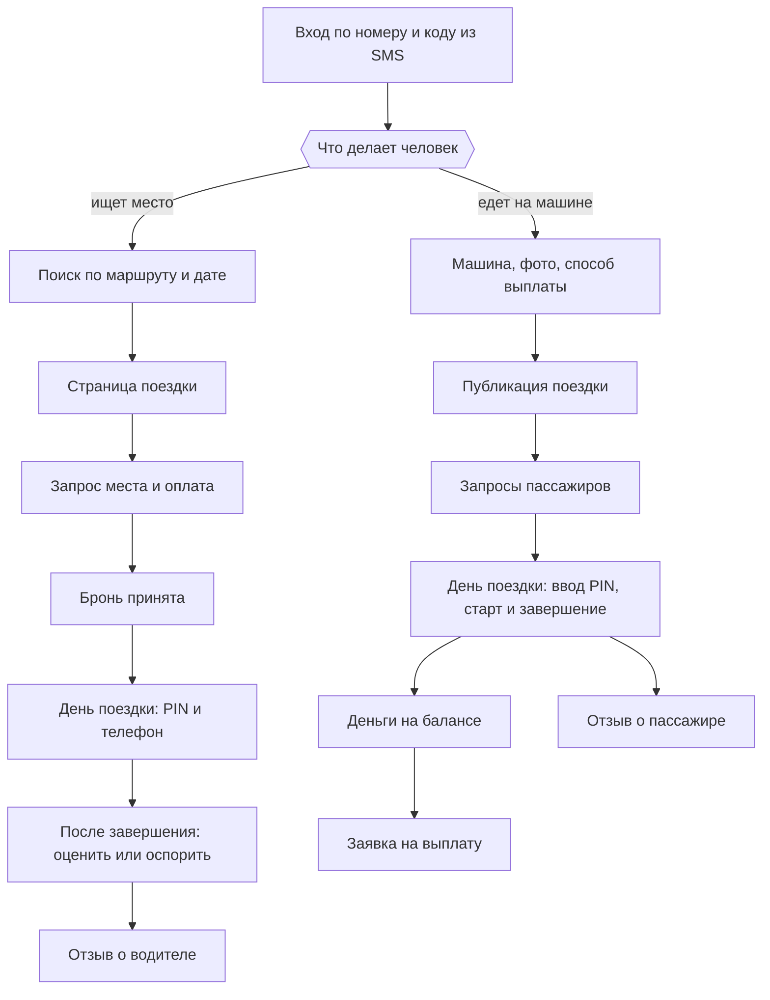

## Вход и регистрация

Регистрация и вход одно действие. Код генерирует и проверяет Supabase Auth, SMS доставляет функция `send-sms` через Castbrick.

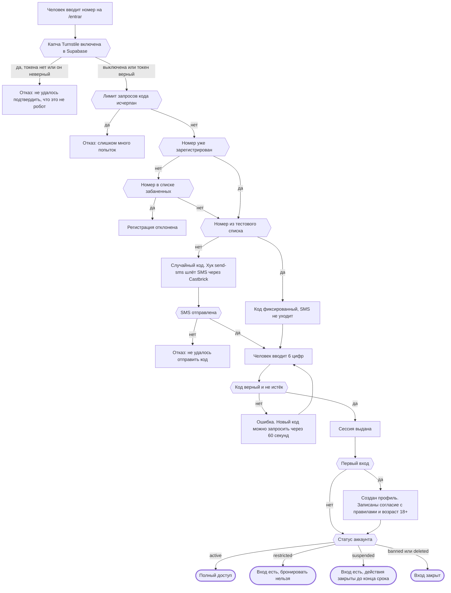

### Что важно

- Тестовые номера входят по фиксированному коду и до хука не доходят. Перед запуском их нужно убрать: среди них админ.
- Капча на сайте стоит, но в Supabase пока выключена: ждёт виджет в мобильном приложении.
- Имя и фото спрашиваются не при входе, а при первой брони или публикации.

## Поездка: от публикации до конца

Поездка живёт своей машиной состояний. Выезд, истечение и завершение делает cron, отмену делает водитель или платформа.

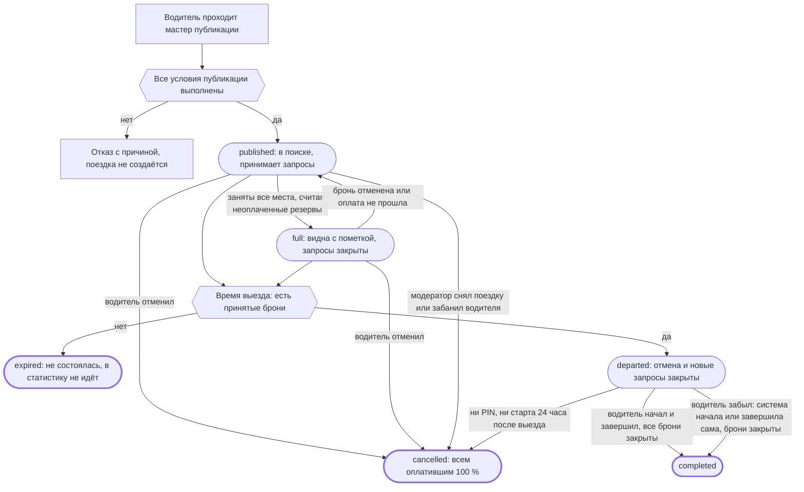

### Условия публикации

- В профиле есть фото, активная машина и способ выплаты.
- Выезд не раньше чем через 2 часа.
- Откуда и куда: только город или посёлок. Точка встречи пишется отдельным полем.
- Мест от 1 до 4, цена за место от 500 до 100 000 Kz, ожидание 30, 45 или 60 минут.
- Не больше 5 активных поездок и 5 публикаций в сутки, нет своей же поездки в пределах 2 часов.

### Что можно менять после публикации

- Цену, места, заметки, багаж, точки, время ожидания: пока нет оплаченных броней.
- Время выезда: пока нет ни одной брони, даже неоплаченной.
- Режим брони (сразу или с подтверждением): всегда, действует на новые брони.
- Машину и города: никогда.

## Бронь и оплата

Место резервируется в момент запроса, ещё до оплаты. Дальше всё решает ответ шлюза Multicaixa Express и режим брони у поездки.

### Запрос места и оплата

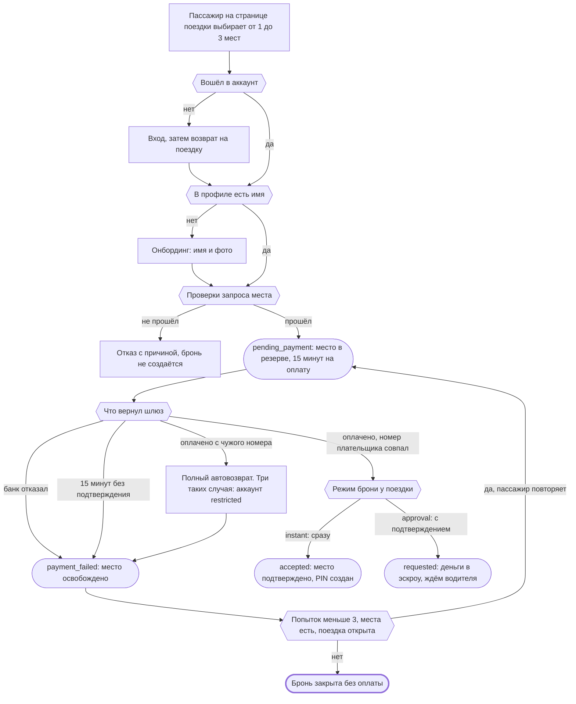

### Бронь с подтверждением: ожидание водителя

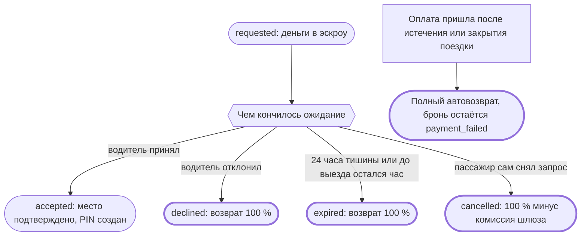

### Проверки запроса места

- Аккаунт не `restricted`, не приостановлен и не забанен.
- Поездка в `published` и до выезда больше часа. В `full` отказ: мест нет.
- Свободных мест хватает на запрошенное число.
- На этой поездке у пассажира ещё нет активной брони.
- Всего активных броней меньше 3, запросов за сутки меньше 10.

### Сумма

- К оплате: цена мест плюс сервисный сбор.
- Сбор: 10 % от цены места, но не меньше 1 000 Kz за каждое место (2 места по 7 000 = 14 000 + 2 000).
- Номер плательщика в Multicaixa Express должен совпадать с номером аккаунта.

## Отмены и возвраты

Сумма возврата зависит от трёх вещей: кто отменяет, в каком статусе бронь и сколько осталось до выезда. Проценты считаются от всей уплаченной суммы, включая сбор.

### Отменяет пассажир

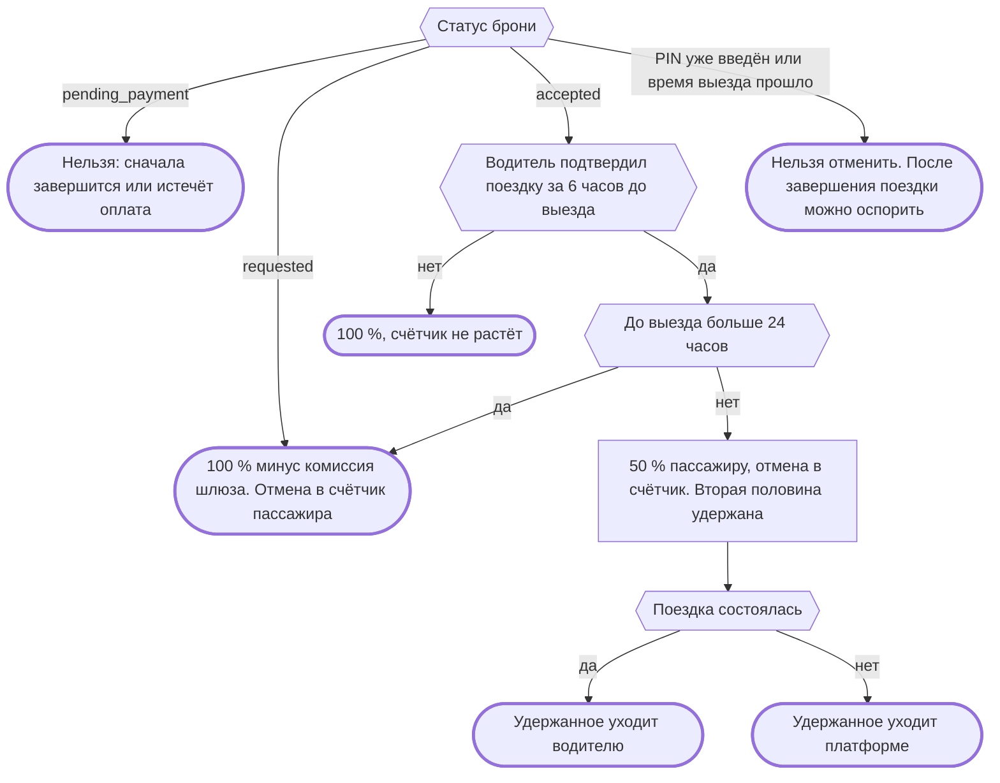

### Отменяет водитель, платформа или срок

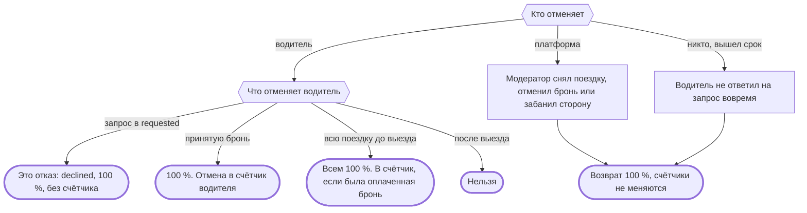

### Что важно

- Точную сумму возврата пассажир видит на экране отмены до подтверждения.
- Комиссию шлюза пассажир несёт только когда отменяет сам и заранее. Во всех остальных случаях её платит платформа.
- Счётчик отмен виден в профиле словами: "Nunca cancelou" или "Às vezes cancela". Автоматических санкций за него нет.

## День поездки по часам

По времени идут только напоминания, открытие PIN и закрытие отмены: их запускает cron раз в 5 минут. Начало и конец поездки отмечает водитель.

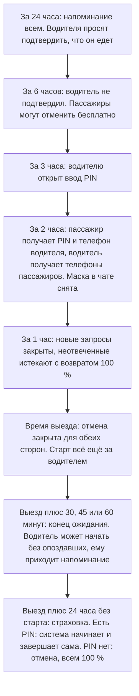

### PIN

- 4 цифры на бронь. Пассажир называет его водителю, садясь в машину.
- PIN видит только пассажир: на странице брони и в уведомлении. В чат уходит сообщение без цифр, водителю PIN не отдаёт ни один запрос.
- Водитель вводит PIN с 3 часов до выезда и до завершения поездки.
- PIN привязан к брони: статус меняется только у того пассажира, чей PIN ввели. Отменить бронь он больше не может.
- 5 неверных вводов за 10 минут: блок на ввод.
- Введённый PIN доказывает, что пассажир сел. Без PIN бронь нельзя завершить, она может закончиться только неявкой, спором или возвратом.

### Телефон

- Виден обеим сторонам только при брони в `accepted` или `awaiting_confirm` и не раньше чем за 2 часа до выезда.
- Каждый просмотр записывается.

## Ход поездки: старт, завершение, спор

Как в такси: водитель вводит PIN, начинает и завершает поездку. Пассажир после завершения оценивает или оспаривает. Деньги уходят водителю после оценки или через 24 часа без возражений, а не в момент нажатия.

### Старт фиксирует, кто сел

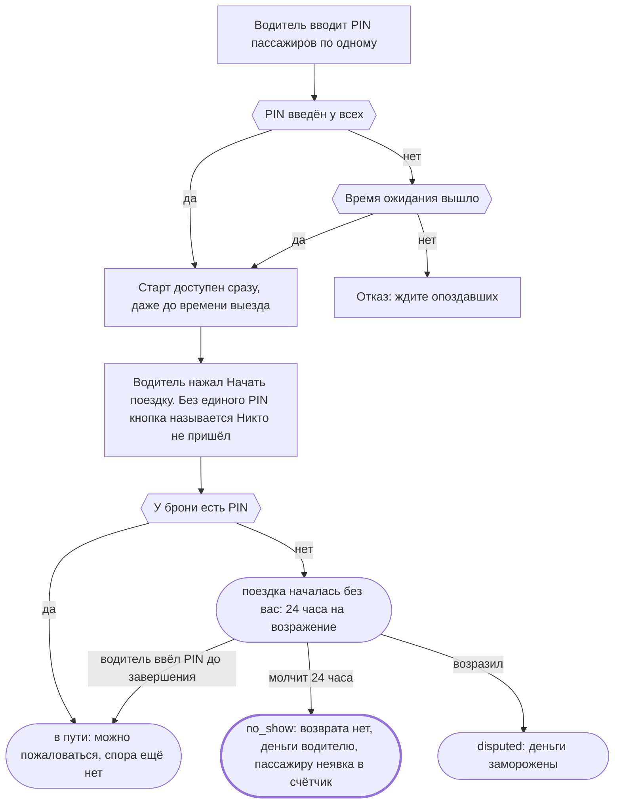

### Завершение и срок на возражение

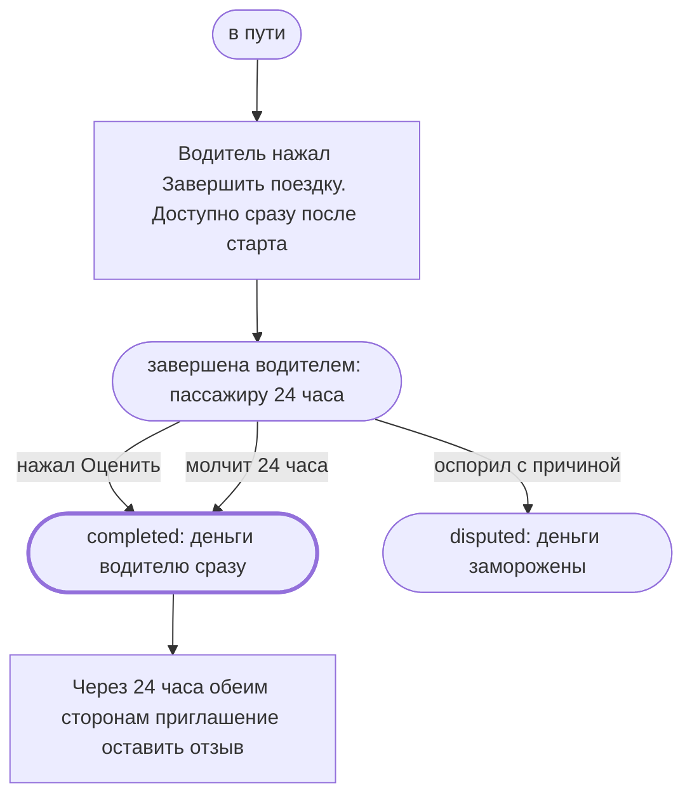

### Если водитель забыл нажать

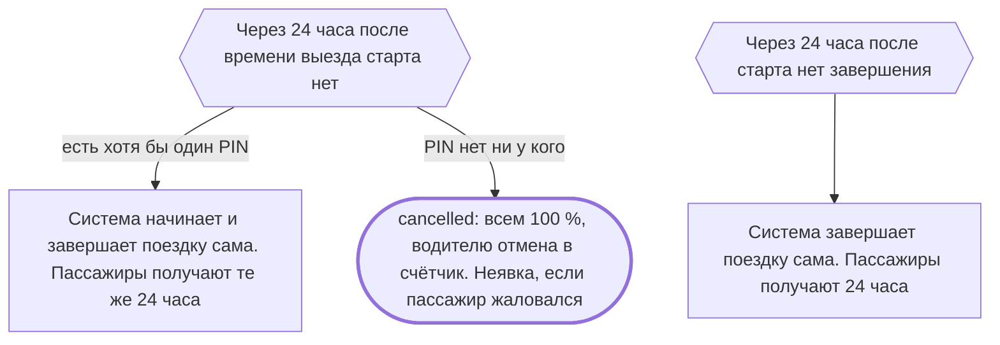

### Спор

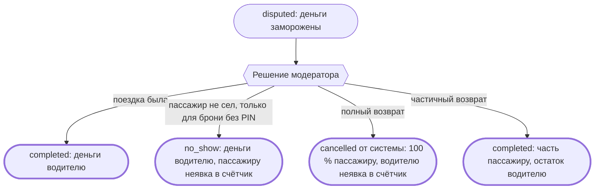

### Жалоба и спор

- Жалоба доступна в пути: уходит модерации, на деньги не влияет.
- Спор доступен после завершения поездки и после "поездка началась без вас". Причина из списка и комментарий обязательны.
- Причины после поездки: не довёз, высадил раньше, опасное вождение, другое. После "началась без вас": был на месте, водитель уехал раньше времени, другое.
- Водитель видит причину спора, но не текст пассажира. Текст читают пассажир и модератор.

### Как решает модератор

- Смотрит причину и комментарий пассажира, чат по брони, PIN, жалобы и версии сторон.
- PIN у спорящего есть: поездка началась с ним, вопрос в том, довезли ли.
- PIN у спорящего нет, а у других пассажиров этой поездки есть: водитель на месте был, это довод против пассажира.
- Частичный возврат: от 1 Kz до суммы в эскроу минус 1 Kz.

## Деньги и выплаты

Каждое движение записывается двойной записью в ledger, клиент сам ничего не считает. Водитель получает цену мест целиком, сбор платит пассажир сверху.

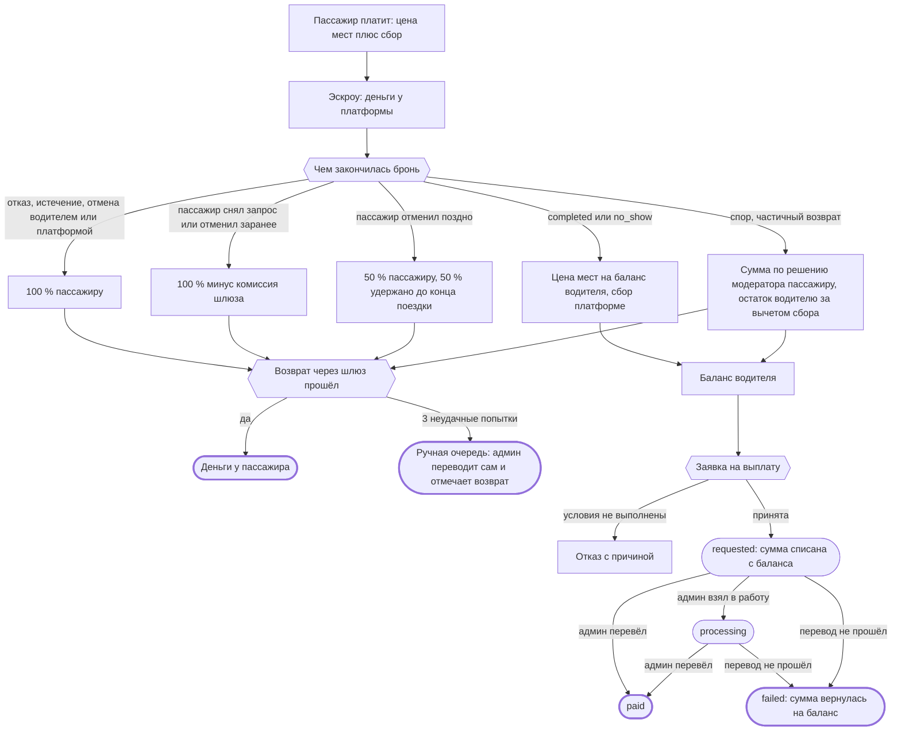

### Условия заявки на выплату

- Сумма от 5 000 Kz и не больше баланса.
- В работе нет другой заявки.
- С прошлой заявки прошло 24 часа.
- Заполнен способ выплаты: Multicaixa Express или IBAN.

### Что важно

- Выплаты делает админ вручную, раз в сутки.
- По ТЗ смена способа выплаты замораживает выплаты на 48 часов.
- Раз в сутки идёт сверка ledger с платежами. Расхождение уходит админам как тревога.

## Верификация водителя

Верификация добровольная. Она даёт значок и место выше в выдаче при равном времени, но не меняет ни лимиты, ни право публиковать, ни выплаты.

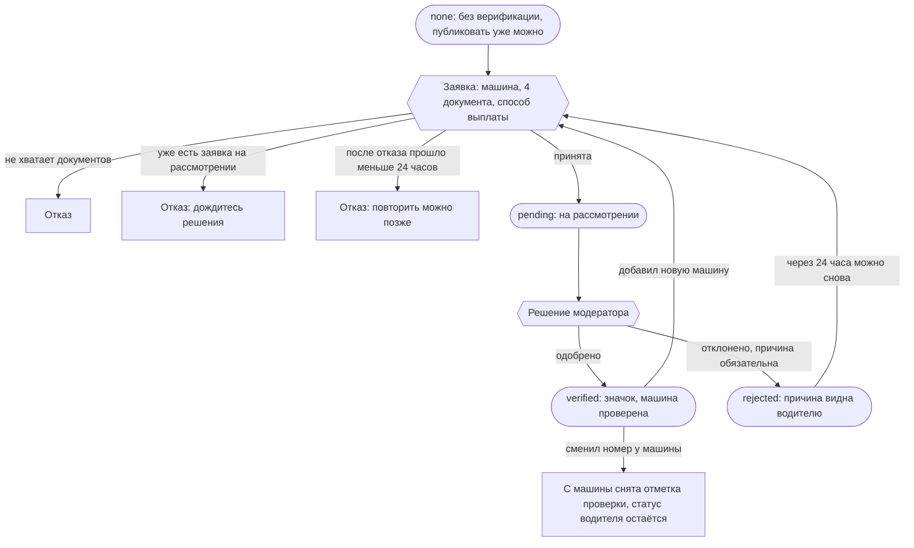

### Документы

- Удостоверение личности, права, фото машины с номером, селфи.
- Лежат в закрытом хранилище, видны только владельцу и модератору.
- Удаляются через 30 дней после решения.

## Чат

Чат один на пару "поездка плюс пассажир" и доступен ещё до брони. До дня поездки телефоны и ссылки в нём скрываются, чтобы сделка не ушла мимо сервиса.

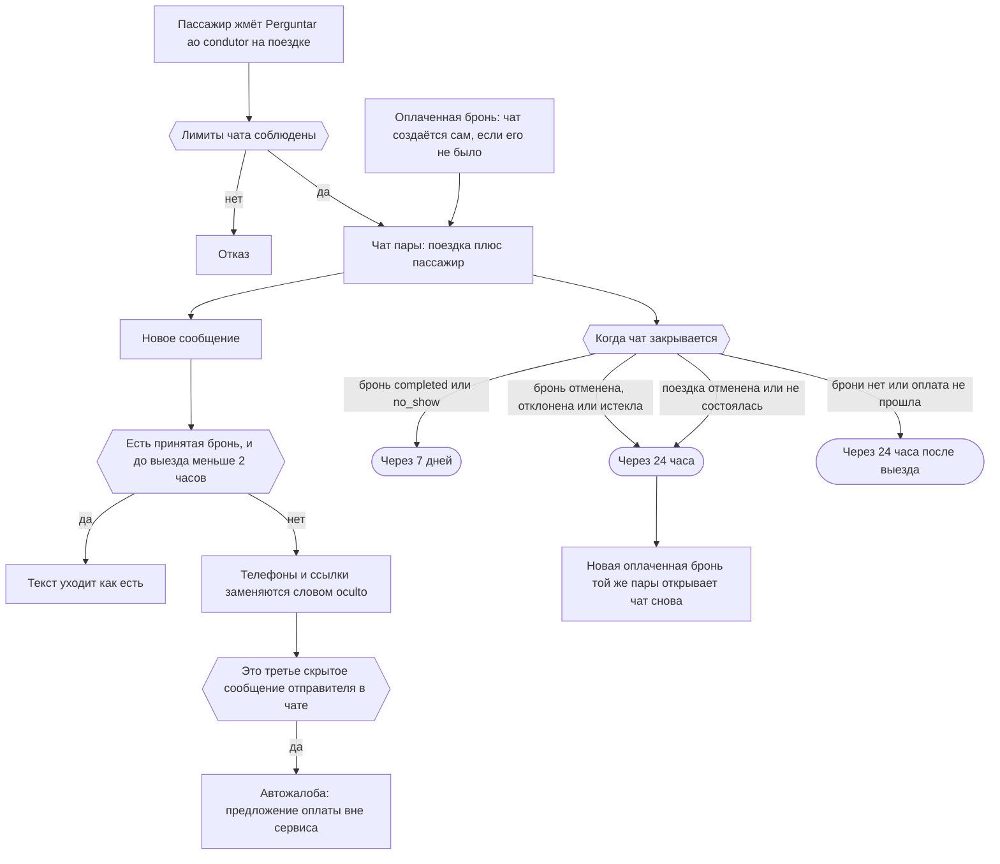

### Лимиты

- 5 новых чатов без брони в сутки.
- 10 сообщений пассажира до оплаченной брони.
- 60 сообщений в минуту.
- Начать чат можно только по поездке в `published` или `full`.

### Кто видит чат

- Только два участника.
- Модератор видит чат, только пока по нему открыта жалоба или спор.

## Отзывы

Оценивают друг друга обе стороны. Отзыв скрыт, пока не ответит вторая сторона или не пройдёт 14 дней: так никто не подстраивает оценку под чужую.

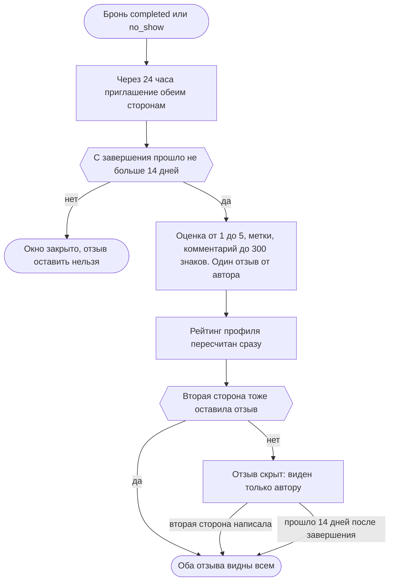

## Жалобы и модерация

Жалобу может подать любой пользователь, часть жалоб создаёт сама система. Каждое действие модератора записывается с причиной, цель получает уведомление.

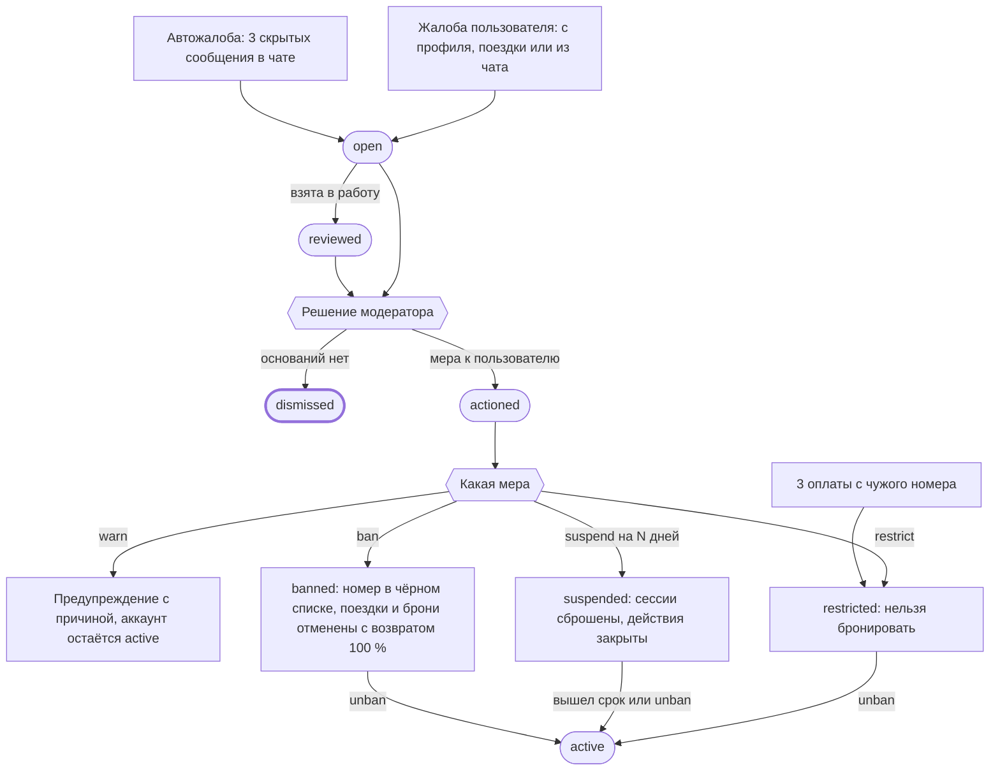

### Ограничения

- Не больше 10 жалоб в сутки от одного человека, на себя жаловаться нельзя.
- К администратору меры применить нельзя.
- У любой меры обязательна причина, у приостановки ещё и число дней.

### Что ещё может модератор

- Снять поездку и отменить бронь от имени платформы: возврат 100 %, счётчики сторон не меняются.
- Одобрить или отклонить верификацию, разрешить спор, отметить выплату и ручной возврат.

## Уведомления

Каждая смена статуса пишет уведомление. Канал выбирается по одному правилу: push, если есть устройство, иначе SMS, но только для событий про деньги и время.

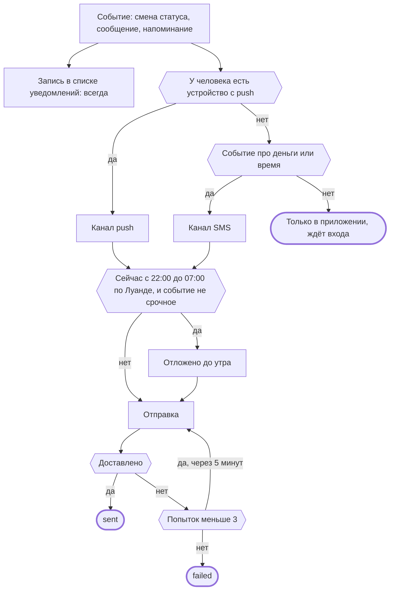

### Срочные события идут и ночью

- Оплата и возврат, бронь принята, отклонена или отменена, отмена поездки.
- PIN и напоминание за 2 часа.
- Споры и тревога сверки.

### Что важно

SMS-уведомления сейчас выключены флагом и пишутся в лог: на общей тестовой базе они ушли бы на несуществующие номера. Коды входа по SMS работают.

## Сроки и лимиты одним списком

Все числа, от которых зависят ветки на схемах выше.

| Значение | Что это | Что происходит |
| --- | --- | --- |
| 15 минут | время на оплату | дальше бронь уходит в `payment_failed`, место освобождается |
| 3 попытки | оплата одной брони | после третьей неудачи повторить нельзя |
| 24 часа | ответ водителя на запрос | молчание: запрос истекает, возврат 100 % |
| 1 час до выезда | граница брони | новые запросы закрыты, неотвеченные истекают |
| 2 часа до выезда | граница доверия | открываются PIN и телефоны, в чате снимается маска; раньше этого срока нельзя опубликовать поездку |
| 6 часов до выезда | подтверждение водителя | без него пассажир отменяет бесплатно |
| 24 часа до выезда | граница отмены пассажиром | раньше: 100 % минус комиссия шлюза; позже: 50 % |
| 30, 45 или 60 минут | ожидание опоздавших | после него водитель может начать поездку без тех, у кого нет PIN |
| 24 часа после завершения | срок на возражение | оценка или молчание закрывают бронь, деньги водителю; спор замораживает |
| 24 часа после старта без пассажира | срок на возражение | молчание: неявка без возврата; возражение: спор |
| 24 часа после выезда без старта | страховка | есть PIN: система начинает и завершает сама; PIN нет: отмена, всем 100 % |
| 24 часа после старта без завершения | страховка | система завершает поездку сама |
| 14 дней | окно отзывов | отзыв можно оставить; одиночный отзыв становится виден |
| 10 %, минимум 1 000 Kz | сервисный сбор | считается за каждое место, платит пассажир |
| 5 000 Kz | минимальная выплата | одна заявка в работе, не чаще раза в 24 часа |
| 5 поездок | активных у водителя | и не больше 5 публикаций в сутки, до 4 мест в поездке |
| 3 брони | активных у пассажира | до 3 мест в одной брони, не больше 10 запросов в сутки |
| 3 машины | активных у водителя | смена номера снимает с машины отметку проверки |
| 3 случая | оплата с чужого номера | аккаунт получает `restricted` |
| 3 сообщения | скрытых в одном чате | автожалоба на попытку оплаты вне сервиса |
